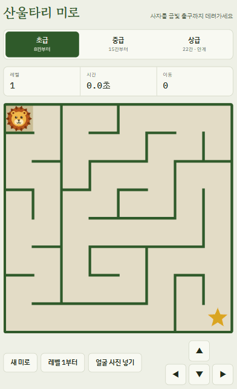
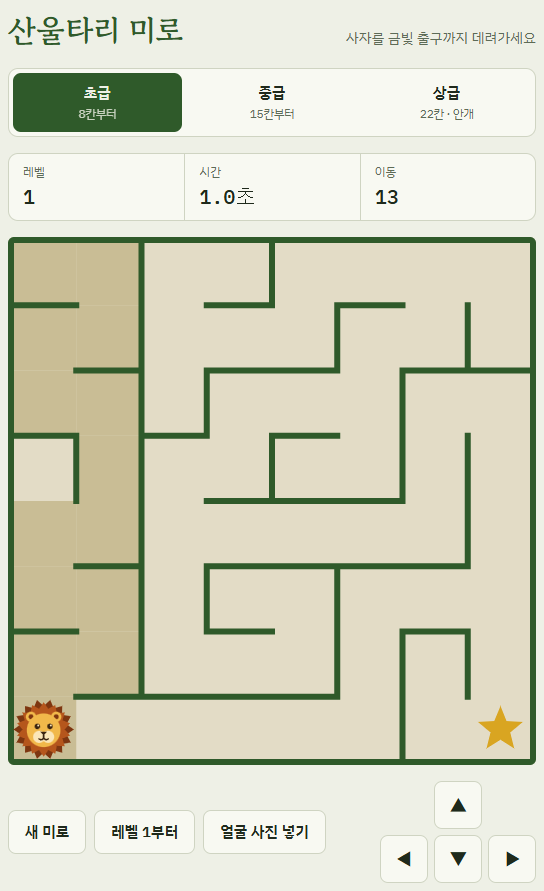
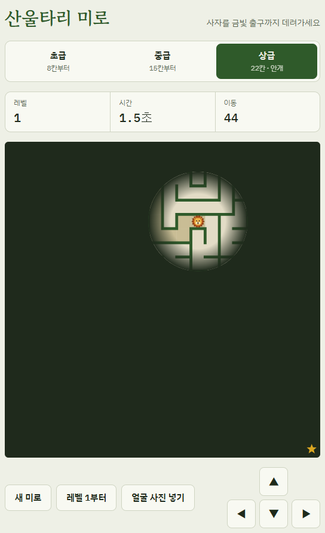

# 🦁 산울타리 미로

**길 잃은 사자를 금빛 출구까지 데려가세요.**
매번 새로 만들어지는 미로, 깰수록 커지는 판, 그리고 앞이 보이지 않는 안개 속 상급 모드.

### [▶ 지금 바로 플레이하기](https://captain92kim-bot.github.io/-/)

설치도 로그인도 필요 없어요. 휴대폰과 PC 브라우저에서 모두 돌아가요.

## 이런 게임이에요

- **매번 새로운 미로:** 같은 미로는 다시 나오지 않아요. 그래도 출구까지 가는 길은 언제나 하나 이상 있어요.
- **세 가지 난이도:** 처음이라면 초급, 자신 있다면 상급에 도전해 보세요.
- **레벨업:** 출구에 닿을 때마다 미로가 더 커져요.
- **기록 도전:** 걸린 시간과 이동 횟수가 남아요. 친구와 같은 난이도로 겨뤄 보세요.
- **내 캐릭터:** '얼굴 사진 넣기'로 사자 대신 원하는 사진을 넣을 수 있어요. 사진은 내 브라우저에만 저장되고 어디에도 올라가지 않아요.

## 난이도

| 난이도 | 첫 미로 | 레벨마다 | 최대 크기 | 특징 |
|---|---|---|---|---|
| 초급 | 8×8 | +2칸 | 20×20 | 가볍게 한 판 |
| 중급 | 15×15 | +3칸 | 32×32 | 본격적인 미로 |
| 상급 | 22×22 | +4칸 | 40×40 | **안개:** 사자 주변만 보여요 |

<table>
<tr>
<td align="center"> 초급: 미로 전체가 보여요</td>
<td align="center"> 상급: 안개 속에서 길을 기억해야 해요</td>
</tr>
</table>

## 조작법

| 기기 | 방법 |
|---|---|
| PC | 방향키 또는 <kbd>W</kbd> <kbd>A</kbd> <kbd>S</kbd> <kbd>D</kbd>, 탈출 후 <kbd>Enter</kbd>로 다음 레벨 |
| 휴대폰 | 게임판을 손가락으로 밀거나 화면의 방향 버튼 |

## 내 컴퓨터에서 실행하기

이 저장소를 내려받아 `index.html`을 브라우저로 열면 바로 할 수 있어요. 따로 설치할 것은 없어요.

---

미로는 깊이 우선 탐색(recursive backtracker) 방식으로 만들어요. 위 플레이 영상은 실제 게임 화면을 녹화한 거예요.
